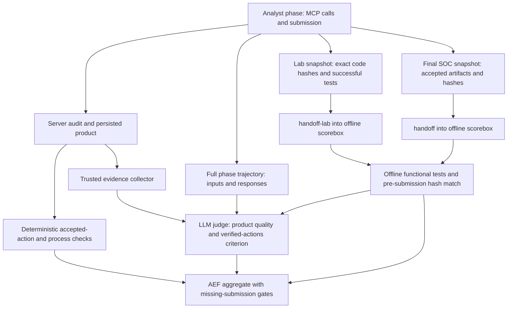

# Action-backed evaluation

Every model scenario now exposes two complementary evidence sources to its judge:
the unfiltered phase trajectory (tool arguments **and responses**) and a trusted
`run_code` collector reading server-owned SOC state/audit events. Claims inside
agent narrative never become receipts. The collector cuts events off at accepted
submission; revision evidence additionally requires UPDATE-01 events.



The lab/scorebox branch applies to v2, v3 and focused rules only. Its judge now
waits for offline execution so actual outcomes are available. Phase evidence
collectors otherwise run alongside snapshots and independent checks; no extra
analyst/model turns are added. v1 is 13 steps, v2 30, v3 37. The functionality
scenario remains model-free and has no narrative judge.

## Scenario coverage

| Scenario | Authoritative evidence and deductions |
| --- | --- |
| v1 | Accepted triage/report receipts, successful intelligence/change/asset reads, nonempty log queries; no accepted submission forces zero even with perfect judge scores |
| v2 | v1 plus accepted evidence/artifact receipts and complete evidence-page coverage before reporting; missing required products forces zero |
| v3 | Baseline evidence plus accepted UPDATE-01 report, post-inject reads, adaptation/retention checks; missing revision forces zero |
| Focused triage | Accepted triage and successful investigation/process events; missing triage forces zero |
| Focused report | Accepted report, pre-report playbook/log retrieval; missing report forces zero |
| Focused rules | Accepted artifact hash, successful valid lab test of identical bytes before acceptance, actual offline precision/recall/coverage |
| Functionality | Trusted fixed fixtures and actual SOC/lab/scorebox verifiers; no model claims to trust |

## Verification results — 2026-11-16

- **112 tests passed** (1.54 seconds), including 20 action-evidence controls:
  unsupported narrative, rejected submissions, failed reads, wrong actor,
  empty queries, partial/late evidence reads, wrong code hashes, failed/late
  lab tests, positive controls, and actual AEF judge-prompt inspection.
- The real direct judge (GPT-6-Sol through the configured LiteLLM proxy) scored
  the false submission narrative **0.00**, and successful reads plus accepted
  submission **1.00**. Reproduce with `scripts/check_action_judge.py`.
- Live focused triage and report completed with score **1.00** each. The judge
  justifications cited successful tool names and accepted receipts.
- Live focused rules completed with score **0.5357**. Only **6/8** submitted
  rule hashes had successful pre-submission lab tests. The judge explicitly
  rejected the claim all eight had been tested and awarded verified actions
  **0.50**; functional execution score **0.7143** became **0.5714** after missing
  lab credit. This is a real observed narrative/action discrepancy, not only
  a synthetic test.
- The consolidated functionality check completed at **1.00** for all three
  verifiers (32.27 seconds). Trusted golden fixtures intentionally do not need
  analyst lab actions and do not use `--require-lab`.
- Live full v3 completed **37/37 steps** (577.49 seconds), final score **0.8367**,
  baseline **0.7900**, revision checks/judge **1.00** each. Exact-hash checks found
  **6/7** baseline artifacts tested; the IOC extractor did not match its lab
  test. Artifact verified actions scored **0.50**. Report verified actions also
  scored **0.50**, demonstrating the criterion can deduct independently of
  content quality. Scores are exploratory, not a model ranking.

The live runs used frozen inputs captured before final wording-only prompt
clarifications and the two additional report read checks. Final generated DAGs
and these last changes are covered by the full regression suite. Runtime SOC/lab
versions used for live checks were soc v5 and lab v2/v3; updated registration is
required for complete page metadata in future runs.

Local test batches (not committed): `1a4f5a40e62641b18c80fa54c13a38d9`
and `5c217656174a4772a2c28336b2c554ce`.

Every baseline judge adds a scored `*-verified-actions` criterion. v1/v2 baseline
judges retain their former total group weight; four criteria each receive 25%.
Focused rules has two equal criteria (logic and verified actions). Revision is
75% product quality and 25% verified actions. Justifications must cite tool
evidence and explain absent, rejected, unsuccessful or late actions.

With `--require-lab`, execution reward is **80% functional tests + 20% verified
lab testing**. Wrong hashes, failed scripts, screen-only calls, missing receipts
and post-submission tests get no lab credit. Result JSON retains per-artifact
hash/test evidence; detailed grading Markdown exposes those failures.

## Scope and limitations

Containment actions, account resets, blocks, escalation and preservation are
**recommendations**, not executable tools in this simulation. Correct proposals
still earn content credit; a claim they already happened is graded as unsupported
by the new actions criterion. This does not claim to verify real-world remediation.
LLM judgments of arbitrary prose remain probabilistic; deterministic gates cover
the observable required actions. Historical stored scores are not overwritten.
Evidence page credit fails closed for older env versions without page metadata;
register the updated SOC/lab before running these tasks.

```bash
uv run agent-env env mcp-server put --id soc --dockerfile soc-env/soc/Dockerfile --context soc-env --platform linux/arm64
uv run agent-env env mcp-server put --id lab --dockerfile soc-env/lab/Dockerfile --context soc-env --platform linux/arm64
uv run python pipelines/v1-triage/build.py
uv run python pipelines/v2-artifacts/build.py
uv run python pipelines/v3-update/build.py
uv run python pipelines/focused/build.py
```

Source references: `pipelines/shared/action_evidence/run.py`, the pipeline
`build.py` files, `check_facts/verify.py`, `check_artifacts/verify.py`,
`check_revision/verify.py`, and `soc-env/scorebox/harness/run_tests.py`.
