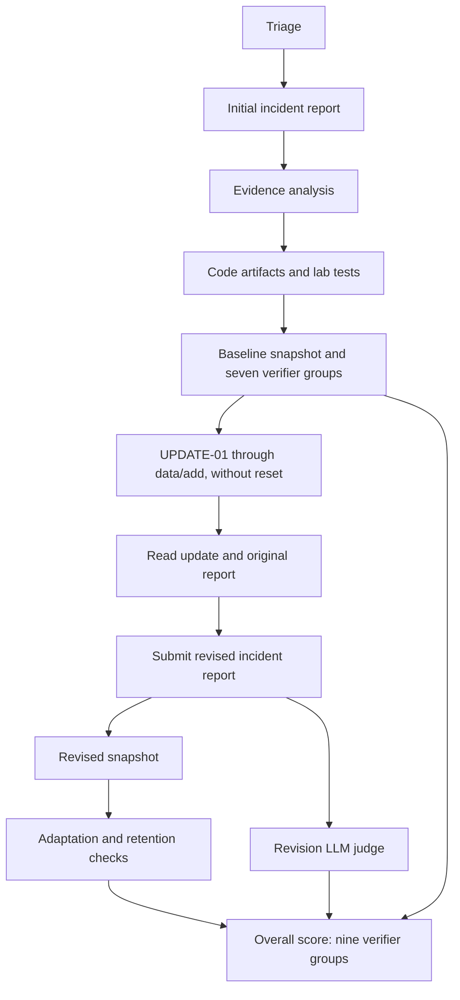

# v3: incident update, report revision and adaptation grading

Extends v2-artifacts with a scripted update after the baseline's four phases and grading finish.
The same analyst conversation reads new telemetry and submits a complete revised incident report.
No model results have been collected for v3 yet.

The local SGP analyst receives v2's base system prompt plus this pipeline's
`prompts/analyst_update_system.md`, covering update discovery, evidence-grounded revisions, preserved
findings and the baseline-only code dataset. `prompts/revision_user.md` drives the fifth phase.
Both prompts are embedded in the generated task by `build.py`; no prompt change is needed in
`agents/sgp-agent/agent.py`, which receives its system prompt and phase messages from AEF.



## Scenario

`update_01.json` appends ALT-1007, four delayed log records and INT-26-032. They establish lateral
movement from SRV-WEB-02 to WS-G1-007 as svc_backup, UpdateSvcHelper persistence, and fallback C2 at
cdn-telemetry.updatesvc.example / 203.0.113.155. The revision should expand scope, isolation, blocks,
preservation and escalation while retaining the original PLANS loss and response. It must not infer
personnel-data exfiltration or domain-controller compromise or merge the unrelated phishing event.

The agent is told an update arrived, but must retrieve its details. This is scheduled, not a virtual-clock
trigger or a test of noticing an unannounced change. Reports remain immutable, one per version.
`soc_list_injects` discovers updates; `soc_get_incident_report(version="INITIAL")` retrieves the baseline;
`soc_submit_incident_report` submits the revision. Identical data/add update retries are idempotent;
reusing an id with different content fails before applying the part.

## Grading and execution boundary

- The original seven verifiers run **before** injection; `soc-v2` remains a separate baseline score.
- `revision-checks` has 34 equally weighted adaptation/process/retention checks totalling 1.0, plus
  unweighted regression traces and a post-update tool-call count. These are scenario-specific text
  heuristics, not a semantic proof; the revision judge covers unsupported claims and reasoning.
- `judge-revision` judges the submitted revision against the original answer key and the new facts.
  Like the baseline, it currently uses GPT-4o, the same model as the analyst.
- `soc-v3` is the mean of nine verifier groups. It is not directly comparable with `soc-v2`; report both.
- This version revises the **incident report only**. Original triage, evidence report and code artifacts
  stay baseline products. Code execution still uses the original log export and hidden ground truth,
  with the handoff from `snap-final`, not `snap-revised`. The lab is not reseeded by the update.
- Host checks remain parse-only; submitted code executes only in the lab and offline scorebox.

## Build, run and export

Re-register the SOC server after pulling these changes (adds report retrieval and versioned audit events):

```bash
uv run agent-env env mcp-server put --id soc --dockerfile soc-env/soc/Dockerfile --context soc-env --platform linux/arm64
uv run python pipelines/v3-update/build.py
uv run agent-env run --dry-run pipelines/v3-update/soc-eval
uv run agent-env run pipelines/v3-update/soc-eval
uv run python pipelines/v3-update/export_run.py "<instance id>"
```

The pipeline uses the latest registered SOC/lab and sgp-agent v1, like v2. The build copies v2's
trusted checks and scorebox context; rebuild v2 first if its source inputs changed. The generated
31-step task is `soc-eval/tasks/soc_update.json`.

Exports under `runs/v3/<instance>/` include the original v2 products, `revised_report.md`,
`revised_state.json`, `revision_checks.json`, the revision trajectory and revised snapshot. The scorecard
shows stored baseline/overall/judge scores and current deterministic adaptation checks separately.

Model-free verification: `uv run pytest` covers append-without-reset, immutable history, one revision per
update, duplicate/conflicting update ids, reset, a golden revision, no-op revision, regression and late-read
controls, injection RPC errors, DAG dependencies and baseline context equality.
